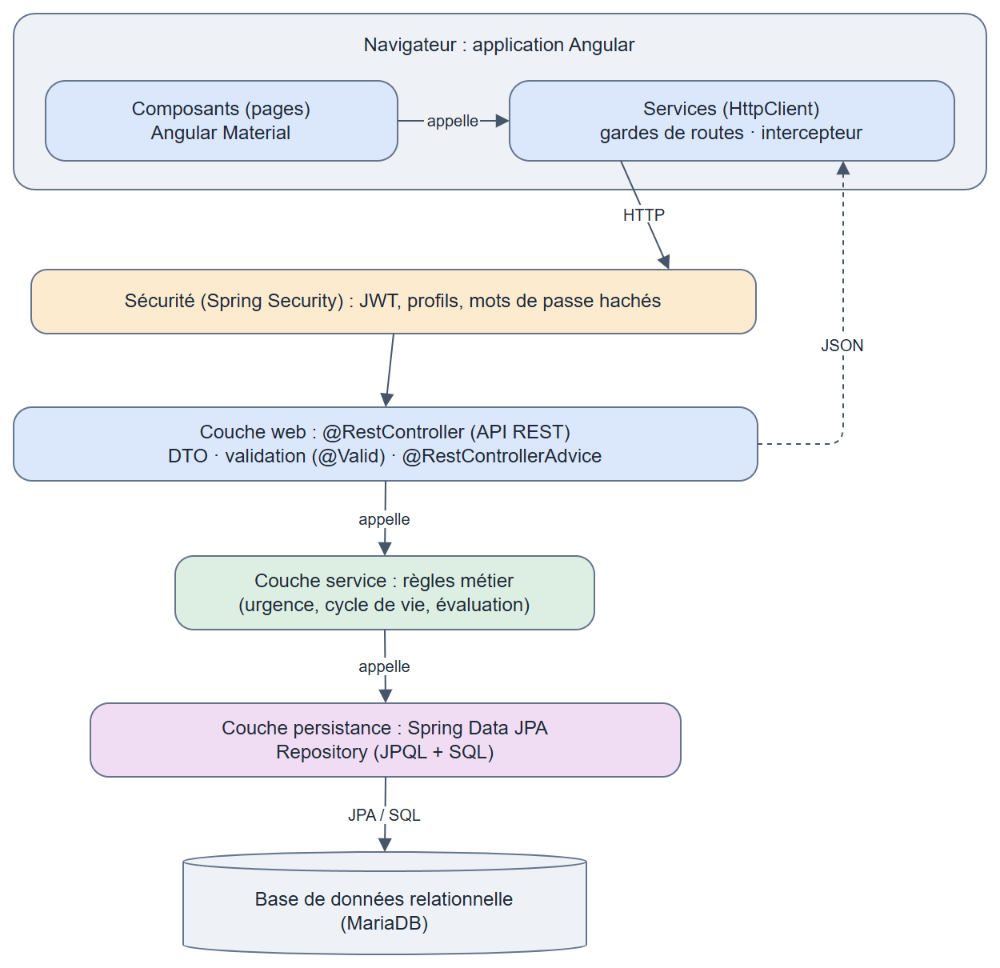

# Journal — Springfield (ALTN72, 2026-27)

**Groupe :** Luc XIANG, Jessy PREUVOT

## README

- **Prérequis :** IntelliJ IDEA et Java 21 pour le backend, MariaDB, Node.js LTS et Angular CLI pour le frontend ; copier `.env.example` en `.env` et le remplir
- **Initialiser la base :** `mysql -u root -p < src/main/resources/script.sql`
- **Lancer :**
  - Backend : ouvrir le projet dans IntelliJ et charger le `pom.xml` pour récupérer les dépendances Maven, puis lancer `SpringfieldApplication` depuis l'IDE (ou `./mvnw spring-boot:run` en ligne de commande)
  - Frontend : `npm install` puis `ng serve`
- **Application déployée :** https://springfield-d105.onrender.com/
- **Comptes de test :**

  | Profil | Identifiant | Mot de passe |
  |---|---|---|
  | Responsable d'exploitation | `resp.exploitation` | `motdepasse-Admin12345@?` |
  | Agent | `agent.terrain` | `motdepasse-Admin12345@?` |

- **Limites connues :**
  - Un CSV vide ou mal formé renvoie une erreur 500.
  - Une note à virgule n'est pas refusée : 2,5 devient 2.
  - Les incidents d'un équipement inexistant renvoient une liste vide au lieu d'une erreur 404.

## ARCHITECTURE

- **Dépôt :**
  - Backend : https://github.com/XiangLuc/Springfield-Backend
  - Frontend : https://github.com/XiangLuc/Springfield-Frontend
- **Schéma :**

  

## TESTS

- **Stratégie :** tests unitaires des règles métier avec JUnit et Mockito, et une horloge fixe pour les seuils d'urgence
- **Commande :** `./mvnw verify` (ou Lifecycle > clean puis package dans IntelliJ) ; il faut le fichier `.env` et une base accessible
- **Couvert :** seuils de 47 h, 48 h et 72 h, cycle de vie des incidents, évaluation, recherche, import et export CSV
- **Non couvert :** contrôleurs (sauf l'affectation), repositories et droits par profil, vérifiés à la main par manque de temps

## CHOIX TECHNIQUES

- **Droits par profil :** seule la description d'un incident non résolu est modifiable, pour que l'agent puisse la préciser.

  | N° | Fonctionnalité | Profil 1 : Responsable d'exploitation | Profil 2 : Agent |
  |---|---|---|---|
  | F2–F3 | Consulter équipements et fiches | Lecture seule | Lecture seule |
  | F4 | Déclarer un incident | Accès complet | Accès complet |
  | F5–F6 | Consulter / modifier un incident | Accès complet | Accès complet |
  | F7 | Affecter ou réaffecter un prestataire | Accès complet | Interdit |
  | F8 | Déclarer un incident résolu | Accès complet | Interdit |
  | F9 | Consulter l'historique | Lecture seule | Lecture seule |
  | F10 | Évaluer un prestataire | Accès complet | Lecture seule |
  | F11 | Tableau de bord | Accès complet | Interdit |

- **Exceptions :** `@RestControllerAdvice`, dans `GestionnaireErreurs`. Toutes les erreurs sont gérées au même endroit et renvoyées de la même façon. C'est plus simple que de mettre des codes HTTP un peu partout dans les services.
- **SOLID :**
  - Appliqués :
    - Responsabilité unique : `PolitiqueUrgence` sert juste à calculer le niveau d'attention, donc si les seuils changent, on ne touche qu'à cette classe.
    - Inversion des dépendances : les contrôleurs passent par des interfaces, et on peut fixer l'heure dans les tests.
  - Non appliqués :
    - Ouvert/fermé : les seuils ne bougent pas, ça aurait compliqué le code pour rien.
    - Liskov : on n'a presque pas d'héritage, à part les exceptions.
    - Ségrégation des interfaces : nos interfaces sont déjà petites.
- **Requête SQL native :** `IncidentRepository.compterStationsTouchees()` compte les stations qui ont un incident en cours. Elle est facile à lire, mais elle casse si on renomme une table, le statut est écrit en dur, et on ne voit une erreur qu'au moment où elle s'exécute. En JPQL, ça aurait été plus sûr.
- **@Transactional :** sur `UtilisateurService.inscrire`, car on vérifie d'abord que le login est libre, puis on crée le compte. Ailleurs, on n'enregistre qu'une seule chose à la fois, et `save` gère déjà sa transaction. On ne l'a pas mis sur l'import CSV, pour garder les bonnes lignes même si d'autres sont fausses.

## LOT ALPHA

### Fonctionnalité transverse 1 : Supervision avancée

- **Besoin :** retrouver vite un incident en combinant plusieurs critères
- **Périmètre envisagé :** recherche multicritère, filtres combinables, tris, pagination
- **Choix et essais :** une requête JPQL à critères facultatifs, plus simple que des Specifications, et une recherche en temps réel dans le frontend
- **Ce qui fonctionne :** mot-clé, filtres par statut, station, prestataire et dates, tris, pagination
- **Difficultés :** garder le frontend et le backend d'accord sur le format de l'API
- **Reste à faire :** vues personnalisées, analyse temporelle

### Fonctionnalité transverse 2 : Import / export de données

- **Besoin :** ajouter beaucoup de stations ou d'équipements d'un coup et récupérer l'historique dans un fichier
- **Périmètre envisagé :** import CSV de stations et d'équipements, export CSV de l'historique
- **Choix et essais :** Apache Commons CSV, avec un import ligne par ligne pour qu'une ligne fausse ne bloque pas les autres
- **Ce qui fonctionne :** import avec les lignes en erreur et leur raison, fichiers d'exemple, export
- **Difficultés :** le caractère invisible (BOM) ajouté par Excel, on gère donc seulement le CSV UTF-8 sans BOM
- **Reste à faire :** accepter les fichiers d'Excel, renvoyer un message clair si le CSV est mal formé

## BILAN

- **Contribution de chacun :**
  - Luc : authentification, évaluation (F10), tableau de bord (F11), API REST (F12), lot alpha, surveillance prestataire partie backend
  - Jessy : script de base initial, équipements et stations (F2, F3), cycle de vie des incidents (F4 à F9) et déploiement de l'application, surveillance prestataire partie frontend
- **Plus grande difficulté et comment elle a été surmontée :** le manque de temps, on s'est donc concentrés sur le socle et les lots alpha faisables. On a aussi perdu du temps sur le déploiement et sur les conflits Git, par manque d'organisation des branches : des DTO changés après un merge dans `develop` pouvaient casser le frontend, qu'on a alors réaligné.
- **Fonctionnalités non réalisées et pourquoi :**
  - Cartographie : choisir une bibliothèque et faire un POC prenait trop de temps.
  - Vues personnalisées et analyse des incidents dans le temps : on a d'abord voulu finir les fonctionnalités obligatoires.
  - Tests d'intégration : manque de temps.
- **Trois points à retenir du cours et du projet :**
  1. Le découpage en couches, qui rend les règles métier faciles à tester.
  2. L'injection de dépendances, qui permet par exemple de fixer l'horloge dans les tests.
  3. Le Clean Code, pour un code facile à relire et des choix techniques justifiés.

## Évolution séance finale

### Ce qu'on a fait

Un prestataire est « sous surveillance » si la moyenne de ses 5 dernières notes est en dessous de 3. Pour l'affecter à un incident, il faut alors confirmer.

- **Backend :** le calcul est dans `PrestataireService`, le refus sans confirmation dans `IncidentService`, et les notes viennent de `EvaluationRepository`.
- **Frontend :** tout se passe dans `incident-details` : la mention dans la liste, le message de confirmation et la mention sur le détail de l'incident.

### Nos choix

- **Confirmation :** si on choisit un prestataire surveillé, le serveur refuse (erreur 409) et rien n'est enregistré. La page affiche alors un message avec « Confirmer l'affectation » et « Annuler ». Si on confirme, la demande repart avec la confirmation.
- **Calcul :** le statut n'est pas gardé en base, on le recalcule à chaque fois.
- **Raccourci :** on fait une requête par prestataire au lieu d'une seule pour tous. C'est plus simple et ça suffit pour notre projet.

### Tests et limites

- **Tests backend :**
  - `PrestataireServiceTest` : les 7 exemples du sujet
  - `IncidentServiceTest` : affectation avec et sans confirmation
  - `IncidentControllerAffectationTest` : erreur 409 et envoi de la confirmation
  - 
- **Limites :**
  - La requête des 5 dernières notes n'a pas de test automatique, on l'a vérifiée à la main.
  - Si un prestataire devient surveillé alors que la page est ouverte, le bouton de confirmation n'apparaît pas : il faut recharger la page.